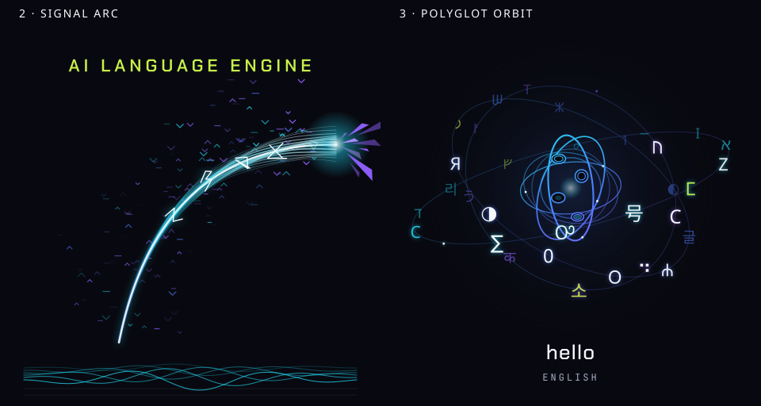

# Zyntalic — original directions 2 and 3

The repository uses the supplied **2 — Signal Arc** and **3 — Polyglot Orbit**
as separate designs. They appear in turn, six seconds per direction, with a
gentle crossfade over a twelve-second loop. The original artwork, colors,
lettering, and full framing are preserved.



## Assets

| File | Contents |
| --- | --- |
| [zyntalic-signal-arc.svg](../zyntalic-flow/public/brand/zyntalic-signal-arc.svg) | Original direction 2, Signal Arc, at 2.2 seconds; static 480 × 480 SVG. |
| [zyntalic-polyglot-orbit.svg](../zyntalic-flow/public/brand/zyntalic-polyglot-orbit.svg) | Original direction 3, Polyglot Orbit, at 1.8 seconds; static 480 × 480 SVG. |
| [zyntalic-logo.svg](../zyntalic-flow/public/brand/zyntalic-logo.svg) | The two original frames alternating every six seconds using native SVG/CSS. |
| [zyntalic-logo-animated.svg](../zyntalic-flow/public/brand/zyntalic-logo-animated.svg) | The same alternating sequence under the explicit animated-asset filename. |
| [zyntalic-lockup.svg](../zyntalic-flow/public/brand/zyntalic-lockup.svg) | Alternating artwork with the original outlined ZYNTALIC wordmark below; 480 × 540. Used in the README. |
| [zyntalic-source-motion.html](../zyntalic-flow/public/brand/zyntalic-source-motion.html) | Self-contained preview running the original Canvas animations for directions 2 and 3, alternating every six seconds. Includes embedded fonts, font licenses, and a play/pause control. Download and open the HTML to view it. |
| [favicon.svg](../zyntalic-flow/public/favicon.svg) | The alternating SVG used by the existing app header and browser icon route. Browser tabs may show a static frame. |

The SVGs contain outlined vector artwork without external fonts, embedded
bitmaps, or scripts. The alternating SVGs transition between source frames;
the HTML preview retains the movement within each original direction.
Reduced motion shows direction 2 as a still. Renderers that ignore SVG animation
also receive that complete static frame. Live browser playback has not been
verified in this environment.



## Integration

The README displays the alternating lockup. The React header and browser icon
use the existing `/favicon.svg` route; the legacy HTML also references it.
Vite includes `public/brand/` in its build output. The FastAPI service does not
expose a general `/brand/` route, so the larger assets and HTML preview are linked
here as repository files.

## Provenance

Source: the owner-supplied **Zyntalic animated logo directions – Zyntalic Animated
Logo (2).html**. The SVGs are exported from directions 2 and 3 of its original
Canvas artwork. All script characters and the original Chakra Petch / JetBrains
Mono typography are outlined. The HTML preview embeds its fonts and their
license notices.

Source attachment SHA-256:

```text
7924a43958f413fc6382408536288da60fbc11ec0dd649d41883a34e5ddf9aab
```

The two directions were restored on 13 November 2026 following the owner's
request to apply them intermittently.
